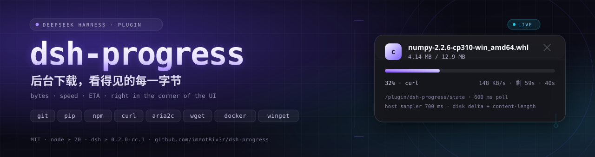
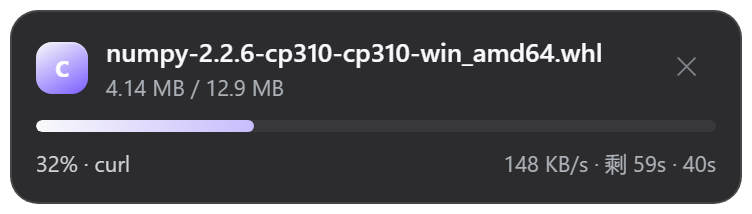
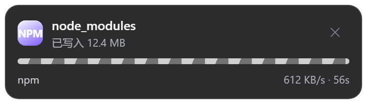
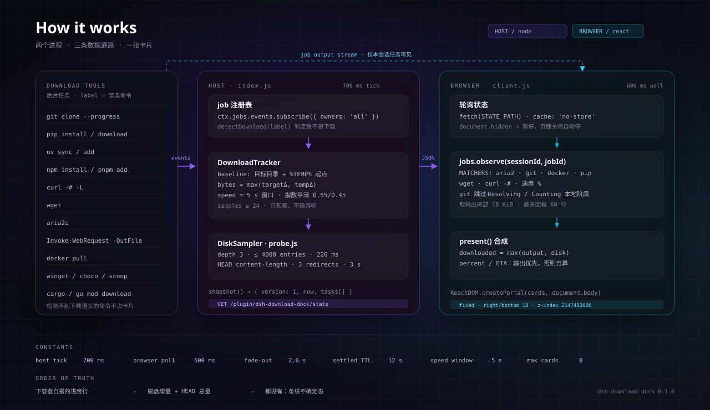
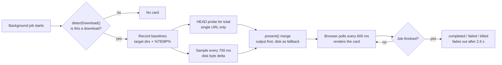

<p align="right"><b>English</b> · <a href="README.zh.md">中文</a></p>

<p align="center">
  
</p>

<p align="center">
  <a href="LICENSE"></a>
  = 20">
  = 0.2.0-rc.1">
  
  
</p>

<p align="center">
  <b>A background download shouldn't be one word: "Running".</b><br>
  <sub>dsh-progress grows a live card in the bottom-right corner: file, progress, bytes, speed and ETA.</sub>
</p>

---

<p align="center">
  
  
</p>

<p align="center">
  <sub>Left: the total is known → a real percentage and an ETA. Right: no single total → moving stripes plus bytes written (a deliberate third state, not a failure).</sub>
</p>

> You start a 2 GB model download in Harness and it goes to the background. The corner of the UI says nothing; the job row says "Running".
> You can't tell whether it's downloading at full speed, stuck on DNS, or already dead.
>
> dsh-progress turns those forty seconds into one card: **file name, 32%, 4.14 MB / 12.9 MB, 148 KB/s, 59s left**.
> No second window, no wrapped commands, no takeover — it observes and draws the result where you are already looking.

## Contents

<details>
<summary>Expand</summary>

- [The problem](#the-problem)
- [Anatomy of a card](#anatomy-of-a-card)
- [How it works](#how-it-works)
- [Three data sources](#three-data-sources)
- [Stripes are not a bug](#stripes-are-not-a-bug)
- [What it watches](#what-it-watches)
- [Install](#install)
- [Config](#config)
- [The state route](#the-state-route)
- [Troubleshooting](#troubleshooting)
- [Limitations](#limitations)
- [Development](#development)
- [License](#license)

</details>

## The problem

Harness pushes download commands into background jobs (`run_in_background: true`) so they don't block the turn. The cost: the UI keeps a single status row, and the next real signal is a completion notice a dozen seconds later. Everything in between is invisible.

dsh-progress fills that gap, and it **only observes**:

| It does | It doesn't |
|---|---|
| Subscribe to job registry events and detect download commands | Consume the model's job cursor |
| Sample disk bytes, probe totals (Host) and parse job output (browser) | Change job state, send signals or kill processes |
| Expose a read-only JSON route to the browser half | Read or write the downloaded files |
| Render a card in the bottom-right corner | Pop dialogs, steal focus or block input |

It never asks you to wrap a command. `git clone`, `pip install`, `curl -o`, `npm install` and `winget install` work as they are; progress-friendly flags only make the card more precise (see [What it watches](#what-it-watches)).

## Anatomy of a card

A card is 366 px wide (clamped to `100vw - 36px` on narrow screens), fixed 18 px from the bottom-right corner, with a blurred glass background that follows Harness' light and dark theme variables. Top to bottom:

| Part | Content | Notes |
|---|---|---|
| Tool badge | `git` / `py` / `npm` / `a2` / `c` / `w` / `web` / `app` / `rs` / `go` / `dk` | Derived from the detected tool |
| Title | File, repo or package name | e.g. `numpy-2.2.6-cp310-win_amd64.whl`, `dsh-progress`, `lodash`; falls back to the first 60 characters of the command |
| Subtitle | Byte progress or status text | `4.14 MB / 12.9 MB`, `12.4 MB written`, `Completed`, `Download failed`, `Cancelled`, `Stopping…` |
| Bar | Filled bar or moving stripes | Filled when the total is known; stripes otherwise (see [Stripes are not a bug](#stripes-are-not-a-bug)) |
| Bottom left | Percentage + tool | The tool alone means indeterminate |
| Bottom right | Speed · ETA · elapsed | Only elapsed once finished |
| Error line | Failure reason | `failed` only; first line of the job's `detail` |

Status maps directly onto the visuals:

| Status | Bar | Subtitle | Bottom right |
|---|---|---|---|
| `running` | filled or striped | bytes / status text | speed · ETA · elapsed |
| `stopping` | unchanged | `Stopping…` | speed no longer updates |
| `completed` | green, 100% | `Completed` | total elapsed |
| `failed` | red | `Download failed` + error line | total elapsed |
| `killed` | red | `Cancelled` | total elapsed |

The `✕` button only removes the card from the current page — **it never stops the job**. Reloading brings the card back if the job is still running.

## How it works

The plugin is split into two halves that talk over a single read-only JSON route:

<p align="center">
  
</p>

| Half | Files | Runtime | Responsibility |
|---|---|---|---|
| Host | `index.js` + `lib/*` | Harness main process (Node.js) | Subscribe to job events, detect downloads, sample disk, probe totals, expose the state route, inject a prompt section |
| Browser | `client.js` | Web GUI (React) | Poll state, read job output, parse progress, merge into cards, portal into `document.body` |

### Lifecycle of one download



1. A command starts with `run_in_background: true` and the job registry emits an event.
2. `detectDownload(label)` decides whether it is a download and resolves candidate output paths.
3. The Host records baselines: current bytes of the target directories and of this tool's existing `%TEMP%` entries.
4. If the command contains exactly one HTTP(S) URL, the Host sends a `HEAD` request and reads `content-length` as the total.
5. Every 700 ms the Host samples only the **delta**, so pre-existing files never count as part of this download.
6. After the job ends, the Host keeps returning it for 12 seconds (`settledTtlMs`) so the browser can render the final state.
7. The browser fetches `/plugin/dsh-progress/state` every 600 ms and pauses while the page is hidden.
8. The browser merges disk bytes with the downloader's own progress lines, renders the card, and fades finished cards out after 2.6 seconds.

## Three data sources

### A. Job output (most accurate)

The browser subscribes to the job's output and scans its last 16 KiB (up to 60 lines) for progress frames:

| Downloader | Sample output | Parsed fields |
|---|---|---|
| aria2c | `[#1a2b3c 12MiB/45MiB(26%) CN:1 DL:1.2MiB ETA:30s]` | percent, downloaded, total, speed, ETA |
| git clone | `Receiving objects: 45% (1234/2740), 1.20 MiB \| 2.30 MiB/s` | percent, downloaded, speed |
| docker pull | `45%\|████  \| 12.3MB/27MB` | percent, downloaded, total |
| pip | `12.9/12.9 MB 491.0 kB/s eta 0:00:00` | downloaded, total, speed, ETA |
| wget | `0K .......... .......... 45% 1.2M 3s` | percent, speed, ETA |
| curl `-#` | `#################   45.0%` | percent |
| generic | any line containing `45%` | percent |

A few details that matter:

- **pip's total comes from its first line.** `Downloading https://.../p.whl (9.7 MB)` is remembered separately; later progress frames only carry bytes downloaded, and the two together produce a percentage.
- **git only counts `Receiving objects`.** `Resolving deltas`, `Counting`, `Compressing`, `Writing`, `Updating` and `Enumerating` are local phases; treating their 100% as download progress makes the bar jump backwards.
- **Speed fallback.** When a line has no `MiB/s`, the parser also looks for a standalone `X MB/s` token in the same line.
- **Swallowed output is gone.** `curl -# ... | Select-Object` and friends eat stdout/stderr; that data source is unavailable and only disk sampling remains.

### B. Disk sampling (covers everything that writes files)

The browser cannot read the filesystem, so the Host samples. Targets aren't guessed — they are parsed from the command text:

| Clue | Sampled target |
|---|---|
| A URL's file name | `<cwd>/<file>`, `<file>.part`, `<file>.tmp` |
| `-o` / `-O` / `--output` / `-OutFile` / `-Destination` / `--dir` and friends | The resolved real path |
| `git clone` | The target repo's `.git` (the working tree is never walked) |
| `npm` / `pnpm` / `yarn` / `uv` | `node_modules` and `.venv` under the working directory |
| `$dir="D:\dl"` in the command | Expanded before resolution; if a variable cannot be resolved the path is **skipped** rather than guessed |
| Everything | `%TEMP%` entries matching the downloader's prefix, plus `.part` / `.partial` / `.crdownload` / `.opdownload` staging files |

`%TEMP%` matching is scoped by downloader prefix (`pip-`, `uv-`, `npm-`, `pnpm`, `npx-`, `yarn-`, `git-`, `winget-`, `choco-`, `scoop-` …) because a Windows temp directory routinely holds hundreds of unrelated `.tmp` files.

Sampling has hard budgets so a huge directory can't stall the main process:

| Parameter | Value | Purpose |
|---|---|---|
| Per-round budget | `220 ms` (50–2000, configurable) | Stops walking as soon as the budget is spent |
| Target / temp split | 45% / 55% | Neither path can starve the other |
| Recursion depth | 3 levels | Avoids descending into nested `node_modules` |
| Entry cap per round | 4000 | Keeps giant trees from eating the whole budget |
| Sampling tick | 700 ms | Smooth enough, cheap enough |
| Speed window | 5 s | Byte delta between the window's first and last sample |
| Smoothing | 0.55 × old + 0.45 × new | Damps sampling jitter |

Every byte count is a **delta**: the Host records the target directory and `%TEMP%` baselines when the task opens, then counts only growth. Files that were already in the directory never count as this download.

### C. HEAD probe (supplies the missing total)

For a **single-file URL** (exactly one HTTP(S) address in the command), the Host sends one `HEAD` request:

- 3 s timeout, at most 3 redirects;
- only a 2xx response's `content-length` counts (a 404 error page has a length too, and it would be wrong);
- failures, non-HTTP(S) URLs and servers that refuse HEAD are silently ignored, and the card falls back to stripes or to the output-derived total;
- multi-URL commands are **not** probed — batch downloads have no single total, so any probe would be wrong.

### Merge rules

The browser merges the two paths like this:

| Field | How it merges |
|---|---|
| `downloaded` | `max(job output, disk delta)` — either can lead temporarily, and the max means progress never steps backwards to zero |
| `total` | job output (including pip's `(9.7 MB)`) → HEAD `content-length`; neither → stripes |
| `percent` | job output → `downloaded / total × 100`; neither → stripes |
| `speed` | job output → disk sampling speed; neither → hidden |
| `eta` | job output → `(total − downloaded) / speed`; neither → hidden |

> A real percentage appears only when the job output carries one, or when the output/HEAD supplies a total. Everything else degrades honestly.

## Stripes are not a bug

Moving stripes mean the plugin is in its indeterminate state: it knows a download is running, how many bytes have landed and how fast, but **not the total**, so it honestly refuses to invent a percentage.

There are only three ways to end up without a total:

1. The downloader doesn't report one (`curl -s`, `wget --quiet`, or output swallowed by a pipe);
2. The command isn't a single HTTP(S) URL (many packages, many URLs) — there is nothing to HEAD;
3. The server refuses HEAD, returns a non-2xx status, times out, or `probeTotals` is disabled.

This is not a fallback to failure but a deliberate third state: **don't fake certainty**. The card still shows `12.4 MB written` and a live speed, so the information isn't zero.

When you will always see a percentage:

| Scenario | Percentage | Total source |
|---|---|---|
| `curl -# -L -o file URL` | ✅ | Hash progress line |
| `curl -s -L -o file URL` | ✅ | HEAD probe |
| `git clone --progress` | ✅ | `Receiving objects` |
| `aria2c` | ✅ | Its own progress line |
| `docker pull` | ✅ | Its own progress line |
| `wget` | ✅ | Its own progress line |
| `pip install` / `python -m pip download` | ✅ | pip's `(9.7 MB)` + disk delta (when the output carries a total) |
| `npm install` / `pnpm add` | ❌ stripes | Dozens of packages, no single total |
| Multi-URL `curl` / `wget` | ❌ stripes | Same reason |
| Silent download from a server without HEAD | ❌ stripes | No source at all |

## What it watches

Detection looks only at the command text (`job.label`) and takes the first matching rule, in a fixed order:

| Tool | Matching commands | Progress source | Badge |
|---|---|---|---|
| git | `git clone` / `fetch` / `pull` / `submodule update` / `lfs pull` | output lines + `.git` sampling | `git` |
| pip | `pip install` / `download` / `wheel`, including `python -m pip` | output lines + `%TEMP%` sampling | `py` |
| uv | `uv pip install` / `add` / `sync` / `lock` / `download` / `export` | disk sampling + `%TEMP%` | `py` |
| npm family | `npm` / `pnpm` / `yarn` / `bun` with `i`, `install`, `ci`, `add`, `dlx`, `create`, `update`, `fetch`, `rebuild` | disk sampling (`node_modules`) | `npm` |
| curl | Any `curl` call that has a URL or an output flag | `-#` output + target sampling | `c` |
| wget | Any `wget` call | output lines + target sampling | `w` |
| aria2 | `aria2c` | output lines + target sampling | `a2` |
| PowerShell | `Start-BitsTransfer`; `Invoke-WebRequest` / `iwr` / `Invoke-RestMethod` / `irm` **with `-OutFile`** | target sampling | `web` |
| Package managers | `winget install` / `download`, `choco install`, `scoop install` / `update`, `nuget install`, `dotnet tool install` / `add package` | `%TEMP%` sampling | `app` |
| Rust / Go | `cargo install` / `fetch` / `vendor` / `update`, `go get` / `mod download` | `%TEMP%` sampling | `rs` / `go` |
| Docker | `docker pull` / `load` / `save` / `build` | output lines | `dk` |

**Explicitly ignored** (no card, no sampling):

- `git status`, `git log`, `git commit` and other non-fetching commands;
- `curl --version`, `wget --help`, `aria2c -h` — version/help only, with neither a URL nor an output flag;
- `pip list`, `pip freeze` — no install/download action;
- `Invoke-WebRequest` without `-OutFile` (usually an API call read into memory, not a download);
- `npm run build`, `npm test` — `run` isn't a download verb;
- commands longer than 8000 characters (keeps pathological labels from slowing the parse).

## Install

Prerequisites:

- DeepSeek Harness `>= 0.2.0-rc.1 < 0.3.0-0` (from `dsh.compatibility` in `package.json`);
- Node.js `>= 20`;
- a working Harness profile (examples below use `desktop`; substitute yours).

### Option A: link a local checkout (development / hacking)

```powershell
git clone https://github.com/imnotRiv3r/dsh-progress.git E:\dshWorkspace\dsh-progress

# Link it into the profile's node_modules (a Windows directory junction; usually no admin needed)
cmd /c mklink /J "$env:USERPROFILE\.dsh\profiles\desktop\node_modules\dsh-progress" "E:\dshWorkspace\dsh-progress"
```

Then add the dependency and the bundle to the profile's `package.json`:

```json
{
  "dependencies": {
    "dsh-progress": "link:E:/dshWorkspace/dsh-progress"
  },
  "dsh": {
    "profile": {
      "bundles": ["...", "dsh-progress"]
    }
  }
}
```

### Option B: install from GitHub

```powershell
cd "$env:USERPROFILE\.dsh\profiles\desktop"
npm install --save "github:imnotRiv3r/dsh-progress"
```

Then add `"dsh-progress"` to `dsh.profile.bundles` in the same `package.json`. The repo has no build step — `exports` points straight at the source, so it works right after install.

### What reloads when

| Change | Takes effect |
|---|---|
| Host half (`index.js`, `lib/*`) | Hot reloads with profile changes |
| Browser half (`client.js`) | **One page refresh** |
| Config (`cordis.patch.yml`) | Hot reload; the browser half picks it up after a refresh |

### Verify

```powershell
# Is the Host half alive? `hits` grows once the browser half attaches.
Invoke-RestMethod http://127.0.0.1:2482/plugin/dsh-progress/state
```

A healthy response looks like:

```json
{ "version": 1, "now": 1731427200000, "tasks": [], "poll": { "hits": 412, "lastHitAt": 1731427200000, "build": "0.1.0" } }
```

Now trigger a visible download (rate-limited to 300 KB/s so the card has time to appear):

```powershell
curl.exe -L -# --limit-rate 300k -o "$env:TEMP\probe.bin" `
  https://mirrors.aliyun.com/pypi/packages/a3/dd/4b822569d6b96c39d1215dbae0582fd99954dcbcf0c1a13c61783feaca3f/numpy-2.2.6-cp310-cp310-win_amd64.whl
```

> **It must be a background job** (`run_in_background: true`, or a foreground command promoted to background on timeout). Foreground commands have no job row, so there is nothing to observe — that follows from Harness' job model.

## Config

The row id is `progress`; edit it in the profile's `cordis.patch.yml`:

```yaml
- id: progress
  name: dsh-progress
  config:
    enabled: true
    guidePrompt: true
    settledTtlMs: 12000
    maxTasks: 8
    sampleBudgetMs: 220
    probeTotals: true
    workingDirectory: ''
```

| Field | Type | Default | Range | Meaning |
|---|---|---:|---|---|
| `enabled` | boolean | `true` | — | Master switch: off means no detection, no sampling, no route |
| `guidePrompt` | boolean | `true` | — | Add the download guidance section to the system prompt |
| `settledTtlMs` | number | `12000` | 1000–120000 | How long the Host keeps returning a finished task |
| `maxTasks` | number | `8` | 1–32 | Maximum cards rendered at once |
| `sampleBudgetMs` | number | `220` | 50–2000 | Per-round disk sampling budget; lower it on huge directories |
| `probeTotals` | boolean | `true` | — | HEAD-probe single file URLs for a total; off means silent downloads stay indeterminate |
| `workingDirectory` | string | process cwd | — | Base for resolving relative paths; empty uses the Harness process cwd |

With `guidePrompt` on, the plugin injects a short system-prompt section: **for download commands prefer `run_in_background: true`, and add progress-friendly flags (`git clone --progress`, `curl -# -L`; wget and aria2c already report progress)**. That section is what determines how often cards actually appear — the model has to put downloads in the background before there is anything to observe.

> Config values are normalized on the Host side (numbers clamped to range and rounded, blank strings fall back to the process cwd), so a malformed value can't crash the plugin.

## The state route

`GET /plugin/dsh-progress/state` returns a read-only JSON snapshot (`cache-control: no-store`):

```json
{
  "version": 1,
  "now": 1731427200000,
  "tasks": [
    {
      "id": "job_7f3a",
      "sessionId": "sess_2b91",
      "tool": "pip",
      "fileName": "numpy-2.2.6-cp310-win_amd64.whl",
      "label": "python -m pip download numpy --no-deps -d E:\\ws",
      "status": "running",
      "startedAt": 1731427188000,
      "finishedAt": null,
      "elapsedMs": 12000,
      "bytes": 4140000,
      "speed": 148000,
      "total": 12900000,
      "detail": null,
      "source": "temp"
    }
  ],
  "poll": { "hits": 412, "lastHitAt": 1731427200000, "build": "0.1.0" }
}
```

| Field | Meaning |
|---|---|
| `version` | Snapshot format version, currently `1` |
| `now` | When the Host built the snapshot |
| `tasks[].id` | Harness job id |
| `tasks[].sessionId` | Owning session; `null` for ownerless jobs, which can only show bytes (their output stream is unavailable) |
| `tasks[].tool` | Detected tool (`git`, `pip`, `npm`, `curl` …) |
| `tasks[].fileName` | Card title (file / repo / package name) |
| `tasks[].label` | Full command text (shown as the card's hover title) |
| `tasks[].status` | `running` / `stopping` / `completed` / `failed` / `killed` |
| `tasks[].elapsedMs` | Milliseconds elapsed (total once finished) |
| `tasks[].bytes` | Monotonic disk delta in bytes |
| `tasks[].speed` | Smoothed bytes per second |
| `tasks[].total` | Total size; `null` when unknown |
| `tasks[].detail` | Failure reason (`null` on success) |
| `tasks[].source` | Whether bytes mainly came from `target` or `temp` |
| `poll.hits` | Requests to this route — direct evidence the browser half is mounted |
| `poll.build` | Build marker of the Host that answered |

For debugging, add `?diag=...` to the URL: the value is truncated to 4000 characters and echoed in `poll.diag`, so you can confirm which build the browser actually reached.

## Troubleshooting

| Symptom | Likely cause | Fix |
|---|---|---|
| No card at all | Not a background job | Use `run_in_background: true`; foreground downloads never show a card |
| | Command doesn't look like a download | Check it against the list above; `npm run build` and `git status` don't count |
| | Browser half not loaded | Refresh the page; confirm `dsh-progress` is in `bundles` |
| | Plugin disabled | Check `enabled`; look for `disabled by config` in the Host log |
| | `webServer` not ready | The plugin retries every 500 ms, 20 times; after that you'll see `webServer never became available` |
| Card appears but bytes stay at 0 | Download doesn't hit disk, or lands somewhere unresolved | Use an explicit `-o` / `-OutFile`; make sure `$var` paths expand to real absolute paths |
| | Directory too deep / too many entries | Raise `sampleBudgetMs`, or download into a shallower directory |
| Card always shows stripes | No total available | HEAD only runs for a single HTTP(S) URL with `probeTotals: true`; multi-package / multi-URL downloads have no single total |
| Card flashes and disappears | Task was very short | Cards stay hidden for the first 500 ms of a run; finished cards still show for 2.6 s, so a quick fade-out is normal |
| Card only appears after a refresh | The browser half doesn't hot reload | Expected — `client.js` changes require a page refresh |
| Numbers freeze mid-download | The job itself is stuck (DNS, TLS, silent server) | The card truthfully shows the last byte count and a zero speed; it does not guess |
| Speed curve wobbles on huge directories | Sampling budget too small | Raise `sampleBudgetMs`, or accept the estimate (see [Limitations](#limitations)) |
| Two `pip` runs bleed into each other | `%TEMP%` is shared | Prefix filtering makes it rare, but concurrent runs of the same tool can still mix; run them serially |

Three-state diagnosis with `poll.hits`:

| `hits` | Meaning | Next step |
|---|---|---|
| Not growing | Browser half isn't loaded | Refresh; check profile `bundles`; check the browser console |
| Growing, no card | Mounting or data problem | Check whether `/state` returns non-empty `tasks`; verify the page renders outside `shell.overlay` |
| Growing, card present, numbers frozen | Sampling isn't matching | Inspect `tasks[].source` and `bytes`; check targets and permissions |

## Limitations

- **Foreground downloads never get a card.** This follows from Harness' job model and cannot be worked around; `run_in_background` is the only entry point.
- **Stripes are not a bug.** Without a total there is no honest percentage. `npm install` and multi-URL batch downloads have no single total by design.
- **`pip` / `npm` print no live progress in a non-TTY pipe.** The percentage is `disk delta ÷ total`; pip's total comes from its own opening line, and npm has even less, so it usually stays indeterminate.
- **`%TEMP%` is shared.** Two concurrent `pip` downloads can bleed into each other's byte counts; prefix filtering only makes it rare, not impossible.
- **Disk sampling is an estimate, not accounting.** Depth 3, 4000 entries, 220 ms budget: very large trees are partially counted and the curve can wobble.
- **HEAD probing covers a single URL only.** Non-HTTP(S) addresses, multi-URL commands and servers that refuse HEAD get no total, and probe failures are silent.
- **Ownerless jobs show bytes only.** A job that doesn't belong to a session has no output stream to observe.
- **State lives in memory.** Restarting Harness clears everything; there is no history and no persistence. This is not a download manager.
- **Sampling is single-threaded and serial.** More concurrent downloads means slower rounds and duller speed curves; the ledger keeps at most `maxTasks × 2` tasks and the snapshot exports the first `maxTasks`.
- **It doesn't verify downloads.** Hashes, signatures, extraction and installation are out of scope; it only looks at bytes.
- **It doesn't throttle or schedule.** It watches downloads, it doesn't manage them.

## Development

```powershell
git clone https://github.com/imnotRiv3r/dsh-progress.git
cd dsh-progress

node test/smoke.mjs   # detection, parsing, merging, browser-half registration — fully offline
npm run check         # node --check on every source file
```

Project layout:

| File | Responsibility |
|---|---|
| `index.js` | Host entry: config normalization, job subscription, state route, prompt injection |
| `lib/detect.js` | Command detection, URL / output-flag / variable expansion, target resolution |
| `lib/tracker.js` | Task ledger, 700 ms sampling tick, speed smoothing, snapshot export |
| `lib/sampler.js` | Budgeted directory byte counting, `%TEMP%` prefix filtering, baselines |
| `lib/probe.js` | HEAD `content-length` probe (timeouts, redirects, status validation) |
| `client.js` | Browser half: polling, output parsing, merging, card rendering and portal mounting |
| `test/smoke.mjs` | Offline smoke test built from excerpts of real command output |
| `docs/*.svg`, `docs/*.png` | README artwork and card renders |

The smoke test covers 10 commands that must be detected, 7 that must not, shell variable expansion, pip `-d` exclusion, invalid `probeContentLength` inputs, git / aria2 / wget / curl progress frames, `present()`'s percentage and ETA, and `client.js`'s module and slot registration. Fixtures are excerpts of real output, and nothing touches the network.

### Design decisions

| Decision | Why |
|---|---|
| Mount with `ReactDOM.createPortal` into `document.body` | The `shell.overlay` container carries `transform` / `overflow`, so a `position: fixed` card inside it gets clipped or positioned against that ancestor — the component runs but nothing is visible |
| 700 ms sampling / 600 ms polling | Fast enough to look continuous, cheap enough to leave the main process and browser alone |
| `downloaded = max(output, disk)` | Either path can lead temporarily; taking the max avoids progress stepping backwards |
| Deltas, not absolute sizes | Download folders usually contain old files that must not count toward this download |
| HEAD for single URLs only | Multi-URL downloads have no single total, so any probe result would be wrong |
| Observe, never intervene | The plugin must not affect job lifecycle, completion notices or model context |
| No hot reload for `client.js` | Harness registers browser modules at page load; edits require a refresh |

## License

[MIT](LICENSE) © imnotRiv3r

---

<p align="center">
  <sub>If this card saves you a few terminal stares, a ⭐ is enough.</sub>
</p>
