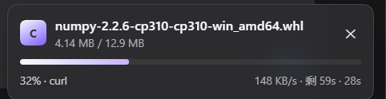
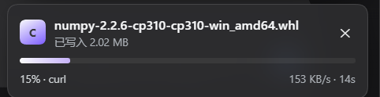

[English](README.md) | 中文

# dsh-progress

DeepSeek Harness 插件：后台任务在下载时，在界面右下角显示一张实时进度卡片（进度条 / 已下载 / 速度 / 剩余时间）。



上图为真实运行时的截图：静默下载（`curl -s`，自身不输出任何进度）仍显示 `4.14 MB / 12.9 MB`、`32%`、`148 KB/s`。

```
┌──────────────────────────────────────┐
│ py  plotly                        ✕  │
│     4.00 MB / 9.70 MB                │
│ ███████████░░░░░░░░░░░░░░░░░░░░░░░░  │
│ 41% · pip            400 KB/s · 剩 14s │
└──────────────────────────────────────┘
```

## 条纹是什么意思

进度条有填充色 = 知道总量，能算百分比。
条纹流动 = **不确定态**：知道在下载、知道已写入多少字节和当前速度，但不知道总量，所以算不出百分比。

这是三个来源都没给出总量时的正常回退，不是坏了。想让它变成百分比，需要「总量」这一项，插件按以下顺序去找：

1. 下载器自己报（`git clone --progress`、`aria2c`、`pip` 的 `(9.7 MB)`）；
2. 对单文件 URL 发一次 HEAD 读 `content-length`（静默 `curl -s` 也靠这条）；
3. 都没有 → 条纹。



`curl -#` 自己会报百分比（上图 `15% · curl`）；`git clone --progress` 同理。真正只能条纹的是**没有单一总量**的下载：`npm install`（多个包）、多 URL 批量下载、以及服务器不支持 HEAD 的地址。

## 它怎么工作

下载进度有三个真实来源，插件都用：

| 来源 | 覆盖 | 说明 |
|---|---|---|
| 任务输出 | git、aria2、wget、curl -#、docker、pip 收尾行 | 直接解析百分比 / 速度 / 总量 |
| 磁盘采样 | 所有会落盘的工具 | 监视 `.git`、`-o` 目标文件、`%TEMP%` 里该下载器的半成品，用字节增长算速度 |
| HEAD 探测 | 单文件 HTTP(S) 下载 | 读 `content-length` 补上总量，让静默下载也能算百分比 |

关键取舍（都实测过）：

- `git clone --progress` 在 Harness 的管道里会输出完整的百分比帧，能直接读。所以提示词会引导模型带上 `--progress`。
- `curl -#` 在管道里同样输出完整百分比（`###########   15.5%`），**前提是命令没有被 `| Select-Object` 之类的管道吞掉输出**。
- `pip` / `npm` 在非 TTY 下**不输出**实时进度（加 `--progress-bar on` 也没用），所以依赖下载靠磁盘采样：pip 实际写的是 `%TEMP%\pip-download-*` / `pip-unpack-*`，采样这些目录就能得到真实的字节曲线与速度。pip 起始行里的 `(9.7 MB)` 提供总量，于是能算出百分比。
- 目标目录只算**增量**：任务开始时会记下目录当时的字节数，避免把目录里的旧文件算成这次下载。

## 界面挂在哪

浏览器半注册到 `shell.overlay` 插槽（root 作用域、默认闲置），再用 `ReactDOM.createPortal` 挂到 `document.body`。

这一步是必须的：插槽容器上有 `transform` / `overflow`，直接在里面放 `position: fixed` 会被裁剪甚至退化成相对祖先定位，表现为「组件在跑、但在界面上看不见」。拿不到 `react-dom` 时退回插槽内渲染。

## 验证

```powershell
# Host 半是否在跑：hits 会在浏览器半挂载后持续增长
Invoke-RestMethod http://127.0.0.1:2482/plugin/dsh-progress/state
# {"version":1,"now":...,"tasks":[...],"poll":{"hits":123,"lastHitAt":...,"build":"0.1.0"}}
```

`poll.hits` 是状态路由被浏览器请求的次数。它不涨说明浏览器半没挂上（通常是页面没刷新）；它在涨但界面没卡片，就该检查挂载位置而不是数据。`poll.build` 是回答请求的 Host 构建标记。

触发一次可观察的下载：

```powershell
curl.exe -L -# --limit-rate 300k -o "$env:TEMP\probe.bin" https://mirrors.aliyun.com/pypi/packages/.../numpy-2.2.6-cp310-cp310-win_amd64.whl
```

## 触发条件

- 必须是**后台任务**（`run_in_background: true`，或者前台命令超时被转成后台）。前台命令没有 job 行，插件看不到。
- 命令文本要能识别成下载：`git clone|fetch|pull`、`pip/uv install|download`、`npm/pnpm/yarn/bun i|install|add`、`curl`、`wget`、`aria2c`、`Invoke-WebRequest -OutFile`、`Start-BitsTransfer`、`winget/choco/scoop/nuget install`、`cargo install|fetch`、`go get|mod download`、`docker pull`。
- 明确排除：`git status`、`curl --version`、`pip list`、没有 `-OutFile` 的 `Invoke-WebRequest` 等。

插件开启 `guidePrompt` 时，会往系统提示词里加一小段：下载类命令优先用 `run_in_background`，并尽量带进度友好参数。这决定你实际能看到多少张卡片。

命令里的 shell 变量会被展开：`$dir="D:\dl"; curl -o "$dir\a.zip" ...` 照样能定位到真实落点。展开不了的变量直接跳过而不是猜一个路径，所以不会因为读错路径画出错误的进度曲线。

## 安装

插件按 Harness 的 profile 方式安装（和本仓库里的 `dsh-job-notify` 一样）。

手动安装：

1. 把本目录链接进 profile 的 `node_modules`：

   ```powershell
   cmd /c mklink /J "C:\Users\<你>\.dsh\profiles\desktop\node_modules\dsh-progress" "E:\dshWorkspace\dsh-progress"
   ```

2. 在 profile 的 `package.json` 加依赖与 bundle：

   ```json
   {
     "dependencies": { "dsh-progress": "link:E:/dshWorkspace/dsh-progress" },
     "dsh": { "profile": { "bundles": ["...", "dsh-progress"] } }
   }
   ```

3. Host 半会随 profile 变更热加载；浏览器半需要**刷新一次页面**。

验证 Host 半：

```powershell
Invoke-RestMethod http://127.0.0.1:2482/plugin/dsh-progress/state
# {"version":1,"now":...,"tasks":[]}
```

## 配置

行 id 是 `progress`，在 profile 的 `cordis.patch.yml` 里改：

```yaml
- id: progress
  name: dsh-progress
  config:
    enabled: true
    guidePrompt: true
    settledTtlMs: 12000
    maxTasks: 8
    sampleBudgetMs: 220
    probeTotals: true
    workingDirectory: ''
```

| 字段 | 默认 | 含义 |
|---|---:|---|
| `enabled` | `true` | 总开关 |
| `guidePrompt` | `true` | 往系统提示词加下载引导（提高能看到卡片的概率） |
| `settledTtlMs` | `12000` | 任务结束后 Host 继续返回该任务的时长 |
| `maxTasks` | `8` | 同时展示的上限 |
| `sampleBudgetMs` | `220` | 单轮磁盘采样预算；大目录多时可调小 |
| `probeTotals` | `true` | 对单文件 URL 发 HEAD 取总大小；关掉后静默下载只能显示条纹 |
| `workingDirectory` | 进程 cwd | 解析命令里相对路径的基准 |

## 已知限制

- **前台下载不显示**。这是 Harness 的 job 模型决定的，不是插件能绕过的。
- **条纹（不确定态）不是 bug**：拿不到总量时只能这样显示。总量来自下载器自报或 HEAD 探测，`npm install` 这类多包下载没有单一总量。
- **`pip` / `npm` 不报实时进度**，卡片上的百分比来自「磁盘增量 ÷ 总量」。pip 的总量从它的起始行拿到。
- **`%TEMP%` 是共享的**：同时跑两个 pip 下载时，字节可能互相计入。按下载器前缀（`pip-*`、`npm-*`…）过滤后这种情况很少，但不保证。
- **磁盘采样是估算**：目录遍历有时间与条目上限，超大目录会只统计一部分，曲线可能略抖。
- **HEAD 探测只对单 URL**：多 URL 命令、非 HTTP(S) 地址、不支持 HEAD 的服务器都拿不到总量，且探测失败会静默忽略。
- 无主任务（不属于任何会话的 job）只显示字节，拿不到输出百分比。
- 改动 `client.js` 后要刷新页面；Host 半的改动通过 profile 热加载生效。

## 开发

```powershell
node test/smoke.mjs          # 识别 / 解析 / 浏览器半注册，全部离线
```

`test/smoke.mjs` 用真实命令输出的节选做样本，不联网。

## 许可

MIT
