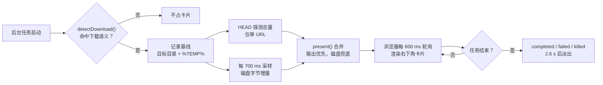

<p align="right"><a href="README.md">English</a> · <b>中文</b></p>

<p align="center">
  
</p>

<p align="center">
  <a href="LICENSE"></a>
  = 20">
  = 0.2.0-rc.1">
  
  
</p>

<p align="center">
  <b>后台下载不再是一个「Running」。</b><br>
  <sub>卡片直接长在界面右下角：文件、进度、字节、速度、剩余时间，一眼看全。</sub>
</p>

---

<p align="center">
  
  
</p>

<p align="center">
  <sub>左：知道总量 → 真实百分比与 ETA。右：没有单一总量 → 流动条纹 + 已写入字节（设计上的不确定性表达，不是故障）。</sub>
</p>

> 你在 Harness 里起了一个 2 GB 的模型下载，命令进了后台。界面右下角什么都没有，任务行只写着「Running」。
> 你不知道它是在全速下载、被 DNS 卡住、还是早就停了。
>
> dsh-download-dock 把那几十秒变成一张卡片：**文件名、32%、4.14 MB / 12.9 MB、148 KB/s、剩 59s**。
> 不另开窗口、不改下载命令、不接管任务——它只是观察，然后把观察结果画在你正在看的地方。

## 目录

<details>
<summary>展开</summary>

- [它解决什么问题](#它解决什么问题)
- [卡片上有什么](#卡片上有什么)
- [工作原理](#工作原理)
- [三条数据通路](#三条数据通路)
- [条纹不是坏掉](#条纹不是坏掉)
- [它能识别什么](#它能识别什么)
- [安装](#安装)
- [配置](#配置)
- [状态接口](#状态接口)
- [排查](#排查)
- [已知限制](#已知限制)
- [开发](#开发)
- [许可](#许可)

</details>

## 它解决什么问题

Harness 的下载类命令经常被放进后台任务（`run_in_background: true`），这样它不会锁住当前回合；代价是界面只剩一行任务状态。十几秒后才有一行结束通知，中间发生了什么完全不可见。

dsh-download-dock 补上的正是这段盲区，并且**只做观察**：

| 它做 | 它不做 |
|---|---|
| 订阅 job 注册表事件，识别下载类命令 | 不消费模型的 job 游标 |
| 采样磁盘字节、探测总量（Host）与解析任务输出（浏览器） | 不改变任务状态、不发送信号、不杀进程 |
| 通过一条只读 JSON 路由把快照交给浏览器 | 不读写下载文件内容 |
| 在右下角渲染卡片 | 不弹窗、不抢焦点、不阻塞输入 |

它也不要求你改命令。`git clone`、`pip install`、`curl -o`、`npm install`、`winget install` 原样跑就行；想要更多可见性时，带上进度友好参数即可（见[它能识别什么](#它能识别什么)）。

## 卡片上有什么

一张卡片 366 px 宽（窄屏时限制在 `100vw - 36px` 以内），右下角固定 18 px 边距，毛玻璃背景，跟随 Harness 的浅色 / 深色主题变量。从上到下：

| 元素 | 内容 | 说明 |
|---|---|---|
| 工具徽标 | `git` / `py` / `npm` / `a2` / `c` / `w` / `web` / `app` / `rs` / `go` / `dk` | 由识别到的工具决定，渐变底色 + 小号字母 |
| 标题 | 文件名、仓库名或包名 | `numpy-2.2.6-cp310-win_amd64.whl`、`dsh-download-dock`、`lodash`；取不到时退化为命令首行前 60 字符 |
| 副标题 | 字节进度或状态文本 | `4.14 MB / 12.9 MB`、`已写入 12.4 MB`、`已完成`、`下载失败`、`已取消`、`正在停止…` |
| 进度条 | 填充条或流动条纹 | 有总量 → 填充百分比；无总量 → 条纹（见[条纹不是坏掉](#条纹不是坏掉)） |
| 左下 | 百分比 + 工具名 | 只有工具名时说明处于不确定态 |
| 右下 | 速度 · ETA · 已用时 | 结束时只显示总用时 |
| 错误行 | 失败原因 | 仅 `failed` 时出现，取 job 的 `detail` 首行文本 |

状态与视觉一一对应：

| 任务状态 | 进度条 | 副标题 | 右下 |
|---|---|---|---|
| `running` | 填充或条纹 | 字节 / 状态文案 | 速度 · 剩余 · 已用 |
| `stopping` | 保持 | `正在停止…` | 不再显示速度 |
| `completed` | 绿色填充，直达 100% | `已完成` | 总用时 |
| `failed` | 红色填充 | `下载失败` + 错误行 | 总用时 |
| `killed` | 红色填充 | `已取消` | 总用时 |

卡片右侧的 `✕` 只是把这张卡从当前页面移除，**不会停止后台任务**；重新刷新页面后会重新出现（如果任务还在跑）。

## 工作原理

插件分成两个半区，它们之间只通过一条只读 JSON 路由通信：

<p align="center">
  
</p>

| 半区 | 文件 | 运行环境 | 职责 |
|---|---|---|---|
| Host 半 | `index.js` + `lib/*` | Harness 主进程（Node.js） | 订阅 job 事件、识别下载、采样磁盘、探测总量、导出状态路由、注入一小段提示词 |
| 浏览器半 | `client.js` | Web GUI（React） | 轮询状态、读取 job 输出、解析进度、合并成卡片、挂到 `document.body` |

### 一次下载的完整生命周期



1. 命令以 `run_in_background: true` 启动，job 注册表发出事件。
2. `detectDownload(label)` 判断它是不是下载，并解析出可能的落盘路径。
3. Host 记录基线：目标目录当前字节数、`%TEMP%` 中该下载器的现有字节数。
4. 若命令里只有一个 HTTP(S) URL，Host 发一次 `HEAD` 读 `content-length`，补上总量。
5. 每 700 ms 采样一次；只算增量，所以目录里的旧文件不会被算进来。
6. 任务结束后，Host 继续返回该任务 12 秒（`settledTtlMs`），让浏览器有时间渲染收尾状态。
7. 浏览器每 600 ms 拉一次 `/plugin/dsh-download-dock/state`；页面隐藏时暂停轮询。
8. 浏览器把「磁盘字节」和「job 输出里下载器自己报的进度」合并，渲染卡片；结束的卡片在 2.6 秒后淡出。

## 三条数据通路

### A. 任务输出解析（最准）

浏览器半会订阅该 job 的输出，从最后 16 KiB、最多 60 行里找进度行。能识别的格式：

| 下载器 | 典型输出（节选） | 解析出的字段 |
|---|---|---|
| aria2c | `[#1a2b3c 12MiB/45MiB(26%) CN:1 DL:1.2MiB ETA:30s]` | 百分比、已下载、总量、速度、ETA |
| git clone | `Receiving objects: 45% (1234/2740), 1.20 MiB \| 2.30 MiB/s` | 百分比、已下载、速度 |
| docker pull | `45%\|████  \| 12.3MB/27MB` | 百分比、已下载、总量 |
| pip | `12.9/12.9 MB 491.0 kB/s eta 0:00:00` | 已下载、总量、速度、ETA |
| wget | `0K .......... .......... 45% 1.2M 3s` | 百分比、速度、ETA |
| curl `-#` | `#################   45.0%` | 百分比 |
| 通用 | 任意行里的 `45%` | 百分比 |

几个细节：

- **pip 的总量来自起始行**：`Downloading https://.../p.whl (9.7 MB)` 里的 `(9.7 MB)` 会被单独记住；后面的进度行只有已下载量，合起来才能算百分比。
- **git 只认 `Receiving objects`**：`Resolving deltas`、`Counting`、`Compressing`、`Writing`、`Updating`、`Enumerating` 都是本地阶段，拿它们的 100% 当下载进度会让进度条在阶段之间来回跳。
- **速度兜底**：某一行没有 `MiB/s` 时，会再找同一行里的独立 `X MB/s` 文本。
- **输出被吞掉就没了**：`curl -# ... | Select-Object` 之类会吞掉 stderr/stdout，这一路解析拿不到数据，只能靠磁盘采样。

### B. 磁盘采样（兜底，覆盖所有会落盘的工具）

浏览器没有文件系统权限，所以由 Host 侧采样。采样目标不是猜的，而是从命令文本里解析出来的：

| 线索 | 采样目标 |
|---|---|
| URL 的文件名 | `<cwd>/<file>`、`<file>.part`、`<file>.tmp` |
| `-o` / `-O` / `--output` / `-OutFile` / `-Destination` / `--dir` 等 | 解析出的真实路径 |
| `git clone` | 目标目录下的 `.git`（不遍历工作树） |
| `npm` / `pnpm` / `yarn` / `uv` | 工作目录的 `node_modules`、`.venv` |
| 命令里的 `$dir="D:\dl"` | 展开后再解析，展开不了就**跳过**（宁可不采样，也不猜错路径） |
| 所有下载器 | `%TEMP%` 中按前缀匹配的脚手架目录，以及 `.part` / `.partial` / `.crdownload` / `.opdownload` 半成品 |

`%TEMP%` 的匹配按下载器限定前缀（`pip-`、`uv-`、`npm-`、`pnpm`、`npx-`、`yarn-`、`git-`、`winget-`、`choco-`、`scoop-` …），因为 Windows 的临时目录常年躺着成百上千个无关的 `.tmp` 文件。

采样有硬预算，避免大目录拖慢主进程：

| 参数 | 值 | 作用 |
|---|---|---|
| 单轮预算 | `220 ms`（可调 50–2000） | 超出预算立即停止遍历 |
| 目标 / 临时预算分配 | 45% / 55% | 两路都不能饿死对方 |
| 递归深度 | 3 层 | 避免深入 `node_modules` 的嵌套地狱 |
| 单轮条目上限 | 4000 | 防止巨型目录吃掉全部时间 |
| 采样节拍 | 700 ms | 足够平滑，又不压主进程 |
| 速度窗口 | 5 s | 用窗口首尾字节差算速度 |
| 平滑 | 0.55 × 旧值 + 0.45 × 新值 | 抑制采样抖动 |

所有字节都是**增量**：任务打开时先记下目标目录和 `%TEMP%` 的基线，之后只统计增长部分。同一个目录里早就存在的文件不会被记成这次下载。

### C. HEAD 探测（补上缺失的总量）

对**单文件 URL**（命令里恰好一个 HTTP(S) 地址），Host 会发一次 `HEAD` 请求：

- 超时 3 秒，最多跟随 3 次重定向；
- 只接受 2xx 响应的 `content-length`（404 的错误页也有长度，不能算）；
- 失败、非 HTTP(S)、服务器不允许 HEAD → 静默放弃，卡片退回条纹或进度行来源；
- 多 URL 命令**不探测**，因为批量下载没有单一总量，探了也是错的。

### 合并规则

浏览器拿到两路数据后按下面的方式合并：

| 字段 | 合并方式 |
|---|---|
| `downloaded` | `max(任务输出, 磁盘增量)`：下载器可能先报字节、磁盘还没跟上；也可能输出被吞、只有磁盘在动。取大值不会让进度倒退回 0 |
| `total` | 任务输出（含 pip 的 `(9.7 MB)`）→ HEAD `content-length`；都没有 → 条纹 |
| `percent` | 任务输出 → `downloaded / total × 100`；都没有 → 条纹 |
| `speed` | 任务输出 → 磁盘采样速度；都没有 → 不显示 |
| `eta` | 任务输出 → `(total − downloaded) / speed`；都没有 → 不显示 |

> 只有「任务输出里有百分比」或「输出/HEAD 给了总量」时才会出现真实百分比；其余情况一律诚实降级。

## 条纹不是坏掉

进度条呈**流动条纹**时，插件处于不确定态：它知道下载在跑、知道写了多少字节、知道当前速度，但**不知道总量**，所以诚实地不显示百分比。

没有总量只有三种可能：

1. 下载器没报（`curl -s`、`wget --quiet`，或输出被管道吞掉）；
2. 命令里不是单个 HTTP(S) URL（多个包、批量 URL），HEAD 无从探起；
3. 服务器拒绝 HEAD、返回非 2xx、超时，或 `probeTotals` 被关闭。

这不是失败回退，而是设计上的第三态：**不确定就不假装确定**。此时卡片仍然显示「已写入 12.4 MB」和实时速度，信息量并没有归零。

什么时候一定能看到百分比：

| 场景 | 是否有百分比 | 总量来源 |
|---|---|---|
| `curl -# -L -o file URL` | ✅ | 哈希进度行 |
| `curl -s -L -o file URL` | ✅ | HEAD 探测 |
| `git clone --progress` | ✅ | `Receiving objects` |
| `aria2c` | ✅ | 自己的进度行 |
| `docker pull` | ✅ | 自己的进度行 |
| `wget` | ✅ | 自己的进度行 |
| `pip install` / `python -m pip download` | ✅ | pip 起始行 `(9.7 MB)` + 磁盘增量（输出里有总大小时） |
| `npm install` / `pnpm add` | ❌ 条纹 | 几十个包，没有单一总量 |
| 多 URL 批量 `curl` / `wget` | ❌ 条纹 | 同上 |
| 服务器不支持 HEAD 的静默下载 | ❌ 条纹 | 无来源 |

## 它能识别什么

识别只看命令文本（`job.label`），按固定顺序匹配第一条规则：

| 工具 | 匹配到的命令 | 进度来源 | 徽标 |
|---|---|---|---|
| git | `git clone` / `fetch` / `pull` / `submodule update` / `lfs pull` | 输出行 + `.git` 采样 | `git` |
| pip | `pip install` / `download` / `wheel`，含 `python -m pip` | 输出行 + `%TEMP%` 采样 | `py` |
| uv | `uv pip install` / `add` / `sync` / `lock` / `download` / `export` | 磁盘采样 + `%TEMP%` | `py` |
| npm 系 | `npm` / `pnpm` / `yarn` / `bun` 的 `i`、`install`、`ci`、`add`、`dlx`、`create`、`update`、`fetch`、`rebuild` | 磁盘采样（`node_modules`） | `npm` |
| curl | 任意 `curl` 调用（带 URL 或输出参数） | `-#` 输出 + 落点采样 | `c` |
| wget | 任意 `wget` 调用 | 输出行 + 落点采样 | `w` |
| aria2 | `aria2c` | 输出行 + 落点采样 | `a2` |
| PowerShell | `Start-BitsTransfer`；`Invoke-WebRequest` / `iwr` / `Invoke-RestMethod` / `irm` **且带 `-OutFile`** | 落点采样 | `web` |
| 包管理器 | `winget install` / `download`、`choco install`、`scoop install` / `update`、`nuget install`、`dotnet tool install` / `add package` | `%TEMP%` 采样 | `app` |
| Rust / Go | `cargo install` / `fetch` / `vendor` / `update`、`go get` / `mod download` | `%TEMP%` 采样 | `rs` / `go` |
| Docker | `docker pull` / `load` / `save` / `build` | 输出行 | `dk` |

**明确排除**（不占卡片、不采样）：

- `git status`、`git log`、`git commit` 等非拉取命令；
- `curl --version`、`wget --help`、`aria2c -h`——只打印版本/帮助、且没有 URL 也没有输出参数；
- `pip list`、`pip freeze`（没有 install/download 动作）；
- 不带 `-OutFile` 的 `Invoke-WebRequest`（绝大多数是读 API 到内存，不是下载）；
- `npm run build`、`npm test`（`run` 不在下载动作里）；
- 长度超过 8000 字符的命令（避免异常长文本拖慢解析）。

## 安装

前置条件：

- DeepSeek Harness `>= 0.2.0-rc.1 < 0.3.0-0`（`package.json` 的 `dsh.compatibility`）；
- Node.js `>= 20`；
- 一个可用的 Harness profile（下面的示例用 `desktop`，按你的实际 profile 名替换）。

### 方式 A：链接本地目录（适合开发 / 自己改代码）

```powershell
git clone https://github.com/imnotRiv3r/dsh-download-dock.git E:\dshWorkspace\dsh-download-dock

# 链接进 profile 的 node_modules（Windows 目录联接，管理员权限一般不需要）
cmd /c mklink /J "$env:USERPROFILE\.dsh\profiles\desktop\node_modules\dsh-download-dock" "E:\dshWorkspace\dsh-download-dock"
```

然后在 profile 的 `package.json` 里加依赖和 bundle：

```json
{
  "dependencies": {
    "dsh-download-dock": "link:E:/dshWorkspace/dsh-download-dock"
  },
  "dsh": {
    "profile": {
      "bundles": ["...", "dsh-download-dock"]
    }
  }
}
```

### 方式 B：从 GitHub 直接安装

```powershell
cd "$env:USERPROFILE\.dsh\profiles\desktop"
npm install --save "github:imnotRiv3r/dsh-download-dock"
```

再把 `"dsh-download-dock"` 加进同一个 `package.json` 的 `dsh.profile.bundles` 数组。仓库没有构建步骤，`exports` 直接指向源码，安装后即可用。

### 生效顺序

| 改动 | 生效方式 |
|---|---|
| Host 半（`index.js`、`lib/*`） | profile 变更后热加载 |
| 浏览器半（`client.js`） | **刷新一次页面** |
| 配置（`cordis.patch.yml`） | 热加载；浏览器半刷新后拿到新配置 |

### 验证

```powershell
# Host 半是否活着（浏览器半挂上后 hits 会持续增长）
Invoke-RestMethod http://127.0.0.1:2482/plugin/dsh-download-dock/state
```

正常输出长这样：

```json
{ "version": 1, "now": 1731427200000, "tasks": [], "poll": { "hits": 412, "lastHitAt": 1731427200000, "build": "0.1.0" } }
```

再触发一次可见的下载（限速 300 KB/s，让卡片有足够时间出现）：

```powershell
curl.exe -L -# --limit-rate 300k -o "$env:TEMP\probe.bin" `
  https://mirrors.aliyun.com/pypi/packages/a3/dd/4b822569d6b96c39d1215dbae0582fd99954dcbcf0c1a13c61783feaca3f/numpy-2.2.6-cp310-cp310-win_amd64.whl
```

> **必须以后台任务运行**（`run_in_background: true`，或前台命令超时被转成后台）。前台命令没有 job 行，插件看不到它——这是 Harness 的 job 模型决定的。

## 配置

行 id 是 `download-dock`，在 profile 的 `cordis.patch.yml` 里改：

```yaml
- id: download-dock
  name: dsh-download-dock
  config:
    enabled: true
    guidePrompt: true
    settledTtlMs: 12000
    maxTasks: 8
    sampleBudgetMs: 220
    probeTotals: true
    workingDirectory: ''
```

| 字段 | 类型 | 默认 | 范围 / 取值 | 含义 |
|---|---|---:|---|---|
| `enabled` | boolean | `true` | — | 总开关：关闭后不识别、不采样、不注册路由 |
| `guidePrompt` | boolean | `true` | — | 往系统提示词加一段下载引导（见下） |
| `settledTtlMs` | number | `12000` | 1000–120000 | 任务结束后 Host 继续返回该任务的毫秒数 |
| `maxTasks` | number | `8` | 1–32 | 同时展示的卡片上限 |
| `sampleBudgetMs` | number | `220` | 50–2000 | 单轮磁盘采样时间预算；大目录卡顿时调小 |
| `probeTotals` | boolean | `true` | — | 对单文件 URL 发 HEAD 取总量；关闭后静默下载只能显示条纹 |
| `workingDirectory` | string | 进程 cwd | — | 解析命令里相对路径的基准目录；留空用 Harness 进程工作目录 |

`guidePrompt` 打开时，插件会注入一段下载引导，大意是：**遇到下载类命令时优先用 `run_in_background: true`，并带上进度友好参数（`git clone --progress`、`curl -# -L`；wget 和 aria2c 本身就会报进度）**。这段提示词决定你实际能看到多少张卡片——模型愿意把下载放进后台，插件才有东西可观察。

> 配置值会在 Host 侧做归一化（数字夹到范围内并取整，空字符串回退到进程 cwd），所以即使写错类型也不会让插件崩掉。

## 状态接口

`GET /plugin/dsh-download-dock/state` 返回一份只读 JSON 快照（`cache-control: no-store`）：

```json
{
  "version": 1,
  "now": 1731427200000,
  "tasks": [
    {
      "id": "job_7f3a",
      "sessionId": "sess_2b91",
      "tool": "pip",
      "fileName": "numpy-2.2.6-cp310-win_amd64.whl",
      "label": "python -m pip download numpy --no-deps -d E:\\ws",
      "status": "running",
      "startedAt": 1731427188000,
      "finishedAt": null,
      "elapsedMs": 12000,
      "bytes": 4140000,
      "speed": 148000,
      "total": 12900000,
      "detail": null,
      "source": "temp"
    }
  ],
  "poll": { "hits": 412, "lastHitAt": 1731427200000, "build": "0.1.0" }
}
```

| 字段 | 说明 |
|---|---|
| `version` | 快照格式版本，当前为 `1` |
| `now` | Host 生成快照的时间戳 |
| `tasks[].id` | Harness job id |
| `tasks[].sessionId` | 任务所属会话；为 `null` 的「无主任务」只能显示字节，拿不到输出百分比 |
| `tasks[].tool` | 识别出的工具名（`git`、`pip`、`npm`、`curl` …） |
| `tasks[].fileName` | 卡片标题（文件名 / 仓库名 / 包名） |
| `tasks[].label` | 完整命令文本（卡片 hover 时显示） |
| `tasks[].status` | `running` / `stopping` / `completed` / `failed` / `killed` |
| `tasks[].elapsedMs` | 已运行毫秒数（结束时为总耗时） |
| `tasks[].bytes` | 磁盘增量字节数（单调不减） |
| `tasks[].speed` | 平滑后的每秒字节数 |
| `tasks[].total` | 总量；`null` 表示未知 |
| `tasks[].detail` | 失败原因（成功时为 `null`） |
| `tasks[].source` | 字节主要来自 `target`（目标路径）还是 `temp`（临时目录） |
| `poll.hits` | 该路由被请求的次数——浏览器半是否挂载的直接证据 |
| `poll.build` | 回答请求的 Host 构建标记 |

调试时可以在 URL 上加 `?diag=...`，内容会被截断到 4000 字符并写进响应的 `poll.diag`，用来确认浏览器侧到底请求到了哪个构建。

## 排查

| 症状 | 可能原因 | 处理 |
|---|---|---|
| 一张卡片都没有 | 命令不是后台任务 | 用 `run_in_background: true`；前台下载永远不会出卡片 |
| | 命令不像下载 | 检查命令是否在识别清单内；`npm run build`、`git status` 不算下载 |
| | 浏览器半没加载 | 刷新页面；确认 `bundles` 里有 `dsh-download-dock` |
| | 插件被关闭 | 检查 `enabled`；看 Host 日志是否出现 `disabled by config` |
| | `webServer` 未就绪 | 插件会以 500 ms 间隔重试 20 次；超时后日志里会有 `webServer never became available` |
| 卡片有，但字节一直是 0 | 下载不落盘或落到未解析路径 | 命令里显式用 `-o` / `-OutFile`；带 `$var` 的路径要确保能展开成真实绝对路径 |
| | 目录太深 / 条目太多 | 调大 `sampleBudgetMs`，或把下载目录移浅一点 |
| 卡片一直显示条纹 | 没有总量 | 单文件 URL 且 `probeTotals: true` 才会走 HEAD；多包 / 多 URL 场景本来就没有单一总量 |
| 卡片出现了一下就消失 | 任务太短 | 运行不足 500 ms 时，卡片在结束前不会出现；结束后仍会显示 2.6 s 的收尾状态，淡出属于正常 |
| 页面刷新后才出现 | 浏览器半不支持热加载 | 这是预期行为；`client.js` 改动必须刷新 |
| 进度条数字突然停住 | 任务被卡住（DNS、证书、服务器无响应） | 卡片仍如实显示「已写入 X」和速度归零；这不是插件的判断 |
| 大目录上速度曲线抖 | 采样预算不足 | 调大 `sampleBudgetMs`，或接受估算误差（见[已知限制](#已知限制)） |
| 两个 `pip` 同时下载时字节串台 | `%TEMP%` 是共享目录 | 按下载器前缀已做过滤，但并发同一工具时仍可能互相计入；串行执行最稳 |

`poll.hits` 的三态诊断：

| `hits` | 含义 | 下一步 |
|---|---|---|
| 不增长 | 浏览器半没加载 | 刷新页面；检查 profile `bundles`；看浏览器控制台 |
| 增长，但没卡片 | 挂载或数据问题 | 看 `/state` 里 `tasks` 是否为空；确认页面在 `shell.overlay` 之外正常渲染 |
| 增长，有卡片，数值不动 | 采样没命中 | 看 `tasks[].source` 和 `bytes`；检查落点与权限 |

## 已知限制

- **前台下载永远没有卡片。** 这是 Harness 的 job 模型决定的，插件无法绕过；`run_in_background` 是唯一入口。
- **条纹不是 bug。** 没有总量时不存在诚实的百分比。`npm install`、多 URL 批量下载不会有单一总量。
- **`pip` / `npm` 在非 TTY 下不打印实时进度。** 百分比来自「磁盘增量 ÷ 总量」；pip 的总量来自它自己的起始行，`npm` 连这个都没有，所以多是条纹。
- **`%TEMP%` 是共享的。** 两个并发的 `pip` 下载可能互相计入字节；按前缀过滤只能降低概率，不能保证隔离。
- **磁盘采样是估算，不是精确计量。** 递归深度 3 层、4000 条目、220 ms 预算，超大目录只统计一部分，曲线会抖。
- **HEAD 探测只覆盖单个 URL。** 非 HTTP(S)、多 URL、拒绝 HEAD 的服务器都拿不到总量，探测失败静默忽略。
- **无主任务只有字节。** 不属于任何会话的 job 拿不到输出流，只能显示磁盘采样结果。
- **状态只在内存里。** 重启 Harness 后没有历史记录，也没有持久化；这不是一个下载管理器。
- **采样是单线程串行的。** 同时有多个下载时，每轮采样会变慢，速度曲线更钝；台账最多保留 `maxTasks × 2` 条，快照只导出前 `maxTasks` 张。
- **不校验下载结果。** 哈希、签名、解压、安装都不在职责内，它只看字节。
- **不做限速或调度。** 它观察下载，不管理下载。

## 开发

```powershell
git clone https://github.com/imnotRiv3r/dsh-download-dock.git
cd dsh-download-dock

node test/smoke.mjs   # 识别、解析、合并、浏览器半注册；完全离线
npm run check         # 对每个源文件跑 node --check
```

项目结构：

| 文件 | 职责 |
|---|---|
| `index.js` | Host 入口：配置归一化、job 订阅、状态路由、提示词注入 |
| `lib/detect.js` | 命令识别、URL / 输出参数 / 变量展开、落点解析 |
| `lib/tracker.js` | 任务台账、700 ms 采样节拍、速度平滑、快照导出 |
| `lib/sampler.js` | 有预算的目录字节统计、`%TEMP%` 前缀过滤、基线 |
| `lib/probe.js` | HEAD `content-length` 探测（超时、重定向、状态校验） |
| `client.js` | 浏览器半：轮询、输出解析、合并、卡片渲染与 portal 挂载 |
| `test/smoke.mjs` | 离线冒烟：真实命令输出节选做 fixture，不联网 |
| `docs/*.svg`、`docs/*.png` | README 视觉素材与卡片渲染样张 |

冒烟测试覆盖：10 条应识别命令、7 条不应识别命令、变量展开、pip `-d` 目录排除、`probeContentLength` 非法输入、git / aria2 / wget / curl 进度行、`present()` 的百分比与 ETA、`client.js` 的模块注册与插槽注册。用真实命令输出的节选做样本，不需要网络。

### 几个设计取舍

| 决策 | 原因 |
|---|---|
| 用 `ReactDOM.createPortal` 挂到 `document.body` | `shell.overlay` 的容器带 `transform` / `overflow`，直接放 `position: fixed` 会被裁剪或相对祖先定位，表现为「组件在跑，但看不见」 |
| 700 ms 采样 / 600 ms 轮询 | 足够快让人眼觉得连续，又不会让主进程和浏览器持续空转 |
| `downloaded` 取 `max(输出, 磁盘)` | 两路都可能暂时领先；取大值避免进度倒退 |
| 只记录增量 | 下载目录里常有历史文件，绝对值会把旧字节算成这次下载 |
| 只对单 URL 做 HEAD | 多 URL 没有单一总量，探测结果一定是错的 |
| 只观察不干预 | 插件不应影响 job 生命周期、完成通知或模型上下文 |
| `client.js` 不走热加载 | Harness 的浏览器模块由页面加载时注册，改完必须刷新 |

## 许可

[MIT](LICENSE) © imnotRiv3r

---

<p align="center">
  <sub>如果这张卡片让你少盯了几次终端，点个 ⭐ 就够了。</sub>
</p>
